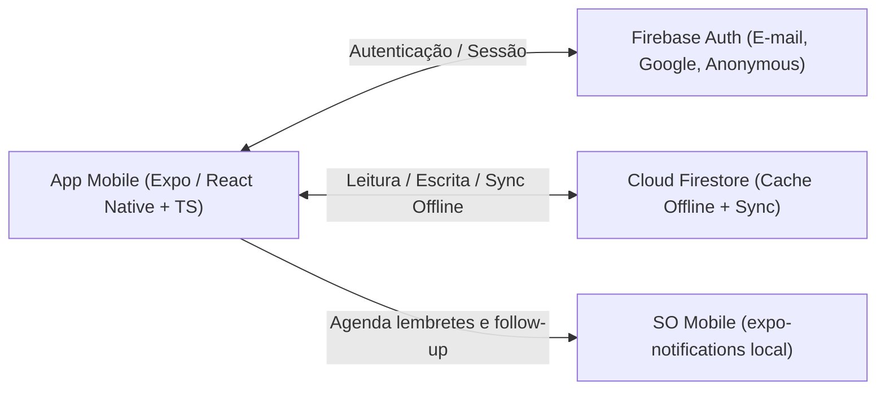

# Documento de Requisitos — `rotina.`

**Instituição:** Instituto Federal de Pernambuco — Campus Garanhuns (IFPE)  
**Curso:** Tecnologia em Análise e Desenvolvimento de Sistemas (TADS)  
**Disciplina:** Desenvolvimento Mobile II — Profa. Mayana Duarte  
**Sistema:** `rotina.` (Aplicativo Mobile de Gestão de Rotina e Hábitos)  
**Versão:** 1.0 — Novembro de 2026

---

## Ficha Técnica

- **Equipe Responsável pela Elaboração:**
  - Álvaro Kayc da Silva Santos — TADS / IFPE Campus Garanhuns (`@alvarokaycss`)
  - João Guilherme Barros dos Santos — TADS / IFPE Campus Garanhuns (`@JoaoGuiBarros`)
  - Pedro Vilela Pereira — TADS / IFPE Campus Garanhuns (`@PedroVilelaPera`)
- **Docente Responsável:** Profa. Mayana Duarte (Desenvolvimento Mobile II)
- **Público-Alvo:** Equipe de desenvolvimento, docente avaliadora da disciplina e responsáveis por especificação (Spec Kit), testes e homologação do MVP.
- **Endereço Institucional:** Rua Pe. Agobar Valença, s/n — Severiano de Moraes Filho, Garanhuns - PE, CEP 55299-390

---

## Introdução

Este documento especifica o aplicativo mobile **`rotina.`**, fornecendo à equipe de desenvolvimento as informações arquiteturais, funcionais, não funcionais e de interface necessárias para o projeto, implementação do MVP, testes e homologação.

### Visão geral deste documento

- **Capítulo 1 — Descrição geral do sistema:** propósito do produto, arquitetura técnica, modelo de dados, escopo positivo, escopo negativo, sistemas relacionados e perfil dos usuários.
- **Capítulo 2 — Requisitos funcionais (casos de uso):** especificação detalhada de todos os casos de uso, agrupados por subseção, com prioridades, entradas, saídas, fluxos principais e fluxos secundários.
- **Capítulo 3 — Requisitos não funcionais:** critérios de usabilidade, confiabilidade, desempenho, segurança, distribuição, padrões e ambiente de hardware/software.
- **Capítulo 4 — Descrição da interface com o usuário:** tokens visuais do Design System (*Warm Obsidian Terracotta*), estrutura das telas (`IF01` a `IF06`) e críticas de interface.

### Convenções, termos e abreviações

#### 1. Identificação dos Requisitos
A referência externa a requisitos segue o padrão `[Nome da subseção.Identificador]`:
- Exemplo funcional: `[Gestao da Rotina.RF005]`
- Exemplo não funcional: `[Seguranca.NF001]`

A numeração (`RF001`, `NF001`) é reiniciada em cada subseção. Uma vez publicada a versão 1.0, os identificadores não devem ser alterados nem reaproveitados.

#### 2. Prioridades dos Requisitos
- **Essencial:** imprescindível para o funcionamento do MVP; entrega obrigatória na v1.
- **Importante:** relevante para uma experiência satisfatória na v1; deve ser implementado no MVP, mas o núcleo do sistema opera sem ele em caso de contingência.
- **Desejável:** não compromete o núcleo da v1; documentado para evolução futura (v2) ou entrega extra caso haja tempo hábil.

#### 3. Glossário
- **Hábito:** ação recorrente (diária ou em dias específicos da semana) com horário agendado obrigatório, podendo ser concluída fora do horário previsto.
- **Tarefa:** ação pontual vinculada a uma data específica (`YYYY-MM-DD`), com horário opcional.
- **Item da rotina:** entidade unificada que representa tanto um Hábito quanto uma Tarefa.
- **Conclusão (`completion`):** registro imutável (ou reversível no mesmo dia) da execução de um item em uma data específica, contendo o timestamp automático `completedAt`.
- **Follow-up no dia seguinte:** notificação local opcional enviada no dia posterior caso um hábito agendado não tenha sido marcado como concluído.
- **MVP (v1):** primeira versão funcional do aplicativo entregue no semestre (Expo + Firebase).

### Referências
1. Template de Documento de Requisitos — UFU-FACOM.
2. Briefing & Especificação Visual do Produto `rotina.` (Tema *Warm Obsidian Terracotta*, v1.0).
3. Documentação oficial Expo SDK & `expo-notifications` (https://docs.expo.dev).
4. Documentação oficial Firebase Auth & Cloud Firestore (https://firebase.google.com/docs).

---

# Capítulo 1 — Descrição Geral do Sistema

O **`rotina.`** é um aplicativo mobile minimalista de organização de rotina e hábitos diários, focado em baixa carga cognitiva, clareza operacional e ausência de cobrança punitiva. O usuário gerencia hábitos recorrentes e tarefas pontuais em uma lista unificada do dia, recebe lembretes locais e acompanha sua consistência por meio de conquistas baseadas em contadores reais.

## Arquitetura Geral e Modelo de Dados

O sistema adota arquitetura **Mobile + BaaS (Expo + Firebase)** com persistência offline nativa e agendamento local de notificações, eliminando a necessidade de manter servidor próprio na v1.

### Estrutura de Dados (Cloud Firestore)
Todas as coleções do usuário são isoladas sob `users/{userId}`:

1. **`users/{userId}`**
   - `displayName`: `string`
   - `email`: `string | null` (`null` em modo visitante)
   - `isAnonymous`: `boolean`
   - `createdAt`: `Timestamp`
   - `settings`: `{ nextDayFollowUpEnabled: boolean, followUpTime: "HH:mm" }`
2. **`users/{userId}/items/{itemId}`** *(entidade unificada para Hábitos e Tarefas)*
   - `type`: `"habit" | "task"`
   - `title`: `string`
   - `category`: `string | null`
   - `note`: `string | null` *(nota pessoal na v1; base de contexto para IA na v2)*
   - `scheduledTime`: `"HH:mm" | null` *(obrigatório para `habit`; opcional para `task`)*
   - `durationMinutes`: `15 | 30 | 45 | 60` *(duração planejada)*
   - `recurrence`: `{ kind: "daily" | "weekly", daysOfWeek: number[] } | null` *(somente `habit`; `0`=Dom .. `6`=Sáb)*
   - `targetDate`: `"YYYY-MM-DD" | null` *(somente `task`)*
   - `isActive`: `boolean` *(exclusão lógica para preservar histórico de conquistas)*
   - `createdAt`: `Timestamp`, `updatedAt`: `Timestamp`
3. **`users/{userId}/completions/{itemId}_{YYYY-MM-DD}`** *(ID determinístico)*
   - `itemId`: `string`
   - `itemType`: `"habit" | "task"`
   - `date`: `"YYYY-MM-DD"`
   - `scheduledTime`: `"HH:mm" | null` *(snapshot do horário planejado no dia)*
   - `completedAt`: `Timestamp` *(horário real capturado automaticamente no check)*

## Abrangência e Sistemas Relacionados

### Escopo Positivo (v1 — MVP)
- Autenticação via E-mail/Senha, Google e Modo Visitante (com conversão posterior para conta definitiva).
- Criação, edição, visualização e exclusão lógica de Tarefas pontuais e Hábitos recorrentes (diários ou por dias da semana).
- Lista unificada do dia com barra de progresso dinâmica, conclusão/desfazer via *check* ou gesto (*swipe*) e registro automático de `completedAt`.
- Notificações locais programadas no horário do hábito e follow-up opcional no dia seguinte para hábitos não concluídos.
- Tela de Conquistas com contadores reais (totalizações, sequências e marcos fixos) e card *Pensamento do Dia*.
- Tela de Ajustes para preferências de notificação e gestão de conta.

### Escopo Negativo (explicitamente fora do sistema)
- **TensorFlow / modelos de ML on-device:** descartado por inadequação técnica; o domínio envolve lembretes agendados e texto natural, não inferência numérica/visão computacional.
- **Geração de lembretes por IA (LLM) na v1:** especificada apenas como requisito *Desejável* para v2 (via API externa de LLM), não implementada no MVP.
- **Upload de foto afetiva e compartilhamento de conquistas na v1:** especificados como *Desejável* para v2.
- **Analytics complexo e gráficos temporais:** incompatíveis com a proposta minimalista de baixa carga cognitiva.
- **Recorrência mensal de hábitos e entrada manual de tempo real gasto:** fora da v1 para evitar atrito de preenchimento.
- **Tema claro (Light Mode):** fora da v1 (tema único *Warm Obsidian Terracotta*).

### Sistemas Relacionados
- **Firebase Authentication:** gestão de identidade, sessões, recuperação de senha, login social e sessões anônimas.
- **Cloud Firestore:** armazenamento em nuvem, sincronização multi-dispositivo e cache local offline.
- **Sistema de Notificações Nativas (Android/iOS via `expo-notifications`):** agendamento e disparo local de lembretes sem dependência de conectividade.

## Descrição dos Usuários

Jovens e adultos que desejam organizar tarefas e hábitos cotidianos sem sobrecarga visual ou métricas punitivas.

### 1. Usuário Visitante
Acessa o aplicativo sem criar conta prévia (via Firebase Anonymous Auth). Utiliza normalmente os recursos locais e sincronizados em sua sessão anônima, podendo convertê-la em conta definitiva a qualquer momento na tela de Ajustes para não perder os dados ao trocar de aparelho.

### 2. Usuário Autenticado
Possui conta vinculada a e-mail/senha ou provedor social (Google/Apple), garantindo sincronização e recuperação de dados entre dispositivos.

---

# Capítulo 2 — Requisitos Funcionais (Casos de Uso)

## Autenticacao e Conta

Agrupa os casos de uso responsáveis por identificação, criação de conta, acesso sem cadastro e encerramento de sessão. **Ator comum:** Usuário (Visitante ou Autenticado).

### [RF001] Cadastro e login com e-mail e senha
- **Prioridade:** ☑ Essencial ☐ Importante ☐ Desejável
- **Interface associada:** `IF01`
- **Entradas e pré-condições:** E-mail válido e senha (mínimo 6 caracteres); dispositivo com acesso à internet.
- **Saídas e pós-condições:** Sessão autenticada ativa no Firebase Auth; documento `users/{userId}` criado/carregado; usuário redirecionado para `IF02`.
- **Fluxo de eventos principal:**
  1. O usuário informa e-mail e senha na `IF01` e aciona o botão primário (`→`) ou seleciona criar nova conta.
  2. O sistema valida o formato do e-mail e o comprimento mínimo da senha.
  3. O sistema autentica ou cria a conta via Firebase Auth.
  4. Em caso de novo cadastro, o sistema cria o perfil inicial em `users/{userId}` com `settings.nextDayFollowUpEnabled = true` e `followUpTime = "09:00"`.
  5. O sistema redireciona o usuário para `IF02`.
- **Fluxos secundários:**
  - *Exceção (credenciais inválidas):* exibir mensagem clara em `semantic.danger` sem limpar o campo de e-mail.
  - *Exceção (sem conexão):* informar que é necessária conexão para autenticar e sugerir tentativa posterior.

### [RF002] Entrar em modo visitante
- **Prioridade:** ☑ Essencial ☐ Importante ☐ Desejável
- **Interface associada:** `IF01`
- **Entradas e pré-condições:** Acionamento da opção *"Entrar sem cadastro (modo visitante)"*.
- **Saídas e pós-condições:** Sessão anônima ativa (`isAnonymous = true`); documento `users/{userId}` criado; redirecionamento para `IF02`.
- **Fluxo de eventos principal:**
  1. O usuário seleciona *"Entrar sem cadastro (modo visitante)"* na `IF01`.
  2. O sistema solicita autenticação anônima ao Firebase Auth.
  3. O sistema cria o perfil inicial em `users/{userId}` com `isAnonymous = true`.
  4. O sistema redireciona o usuário para `IF02`.
- **Fluxos secundários:**
  - *Exceção (falha de rede):* exibir aviso de erro de conexão e permitir nova tentativa.

### [RF003] Converter conta visitante em conta definitiva
- **Prioridade:** ☐ Essencial ☑ Importante ☐ Desejável
- **Interface associada:** `IF06`
- **Entradas e pré-condições:** Usuário autenticado em modo visitante (`isAnonymous = true`); credenciais de e-mail/senha ou Google.
- **Saídas e pós-condições:** Conta anônima vinculada às credenciais definitivas (`linkWithCredential`), mantendo intactos `items` e `completions` sob o mesmo `userId`; `isAnonymous` atualizado para `false`.
- **Fluxo de eventos principal:**
  1. O usuário acessa `IF06` e seleciona *"Criar conta para salvar na nuvem"*.
  2. O usuário fornece e-mail/senha ou seleciona Google.
  3. O sistema vincula a credencial à sessão anônima atual via Firebase Auth.
  4. O sistema atualiza `users/{userId}` com `email` e `isAnonymous = false` e exibe confirmação.
- **Fluxos secundários:**
  - *Exceção (e-mail já cadastrado):* informar que o e-mail já possui conta e oferecer opção de fazer login nela (alertando que os dados locais da sessão visitante não serão mesclados automaticamente).

### [RF004] Recuperar senha por e-mail
- **Prioridade:** ☐ Essencial ☑ Importante ☐ Desejável
- **Interface associada:** `IF01`
- **Entradas e pré-condições:** E-mail válido informado pelo usuário; conexão ativa.
- **Saídas e pós-condições:** E-mail de redefinição enviado pelo Firebase Auth; feedback neutro exibido ao usuário.
- **Fluxo de eventos principal:**
  1. O usuário aciona *"Esqueceu?"* na `IF01`.
  2. O usuário informa seu e-mail e confirma.
  3. O sistema solicita o envio de redefinição ao Firebase Auth.
  4. O sistema exibe mensagem informando que, se o e-mail estiver cadastrado, as instruções foram enviadas.
- **Fluxos secundários:**
  - *Exceção (e-mail inválido):* destacar erro de formato antes do envio.

### [RF005] Autenticar com conta Google
- **Prioridade:** ☐ Essencial ☑ Importante ☐ Desejável
- **Interface associada:** `IF01`
- **Entradas e pré-condições:** Acionamento do botão *Google*; conexão ativa.
- **Saídas e pós-condições:** Sessão autenticada via OAuth Google + Firebase Auth; redirecionamento para `IF02`.
- **Fluxo de eventos principal:**
  1. O usuário toca no card *Google* na `IF01`.
  2. O sistema abre o fluxo OAuth do Google e obtém o token de identidade.
  3. O sistema autentica o token no Firebase Auth e cria/carrega `users/{userId}`.
  4. O sistema redireciona para `IF02`.
- **Fluxos secundários:**
  - *Alternativo (usuário cancela o seletor Google):* retornar silenciosamente à `IF01`.

### [RF006] Autenticar com conta Apple
- **Prioridade:** ☐ Essencial ☐ Importante ☑ Desejável
- **Interface associada:** `IF01`
- **Entradas e pré-condições:** Dispositivo iOS compatível; acionamento do botão *Apple*.
- **Saídas e pós-condições:** Sessão autenticada via Sign in with Apple + Firebase Auth; redirecionamento para `IF02`.
- **Fluxo de eventos principal:** Segue fluxo análogo ao `[Autenticacao e Conta.RF005]` utilizando o provedor Apple.

### [RF007] Encerrar sessão (Logout)
- **Prioridade:** ☑ Essencial ☐ Importante ☐ Desejável
- **Interface associada:** `IF06`
- **Entradas e pré-condições:** Usuário com sessão ativa.
- **Saídas e pós-condições:** Sessão encerrada no Firebase Auth; notificações locais agendadas canceladas; redirecionamento para `IF01`.
- **Fluxo de eventos principal:**
  1. O usuário seleciona *"Sair"* em `IF06`.
  2. Se `isAnonymous = true`, o sistema exibe alerta confirmando que dados de visitante podem ser perdidos sem conta vinculada.
  3. Após confirmação, o sistema cancela lembretes locais, encerra a sessão no Firebase Auth e redireciona para `IF01`.

---

## Gestao da Rotina

Agrupa os casos de uso do núcleo diário de tarefas e hábitos. **Ator comum:** Usuário.

### [RF001] Visualizar rotina e progresso diário
- **Prioridade:** ☑ Essencial ☐ Importante ☐ Desejável
- **Interface associada:** `IF02`
- **Entradas e pré-condições:** Usuário autenticado (ou visitante); data atual do dispositivo (`YYYY-MM-DD`).
- **Saídas e pós-condições:** Lista unificada do dia exibida (hábitos ativos aplicáveis ao dia da semana atual + tarefas pontuais com `targetDate == hoje`), ordenada por `scheduledTime` (itens sem horário ao final); barra de progresso atualizada (`concluídas / total`).
- **Fluxo de eventos principal:**
  1. O sistema carrega `items` ativos do usuário (cache local imediato + sync Firestore).
  2. O sistema filtra hábitos cuja recorrência inclua o dia da semana atual e tarefas com `targetDate == hoje`.
  3. O sistema consulta `completions` referentes à data de hoje.
  4. O sistema renderiza a saudação, a data por extenso, o card de progresso (`X de Y concluídas`) e a lista unificada.
- **Fluxos secundários:**
  - *Alternativo (nenhum item para hoje):* exibir estado vazio acolhedor com convite para criar o primeiro item (`+`).

### [RF002] Criar tarefa pontual
- **Prioridade:** ☑ Essencial ☐ Importante ☐ Desejável
- **Interface associada:** `IF02`, `IF03`
- **Entradas e pré-condições:** Tipo = `task`; `title` obrigatório (1–80 caracteres); `targetDate` (padrão: hoje); `category`, `scheduledTime`, `durationMinutes` e `note` opcionais.
- **Saídas e pós-condições:** Documento criado em `users/{userId}/items/{itemId}` com `type = "task"` e `isActive = true`; `IF02` atualizada imediatamente.
- **Fluxo de eventos principal:**
  1. O usuário aciona `+` ou *"Nova tarefa"* na `IF02`, abrindo `IF03`.
  2. O usuário seleciona o tipo *"Tarefa do dia"*, preenche o título e campos opcionais e confirma.
  3. O sistema valida os campos obrigatórios, persiste o documento no Firestore e fecha `IF03`.
- **Fluxos secundários:**
  - *Exceção (título vazio):* impedir envio e exibir aviso discreto no campo título.

### [RF003] Criar hábito recorrente
- **Prioridade:** ☑ Essencial ☐ Importante ☐ Desejável
- **Interface associada:** `IF02`, `IF03`
- **Entradas e pré-condições:** Tipo = `habit`; `title` obrigatório; `scheduledTime` obrigatório (`HH:mm`); `durationMinutes` (`15`/`30`/`45`/`60`, padrão `30`); `recurrence.kind` (`daily` ou `weekly`); se `weekly`, ao menos 1 dia selecionado em `daysOfWeek`.
- **Saídas e pós-condições:** Documento criado em `users/{userId}/items/{itemId}` com `type = "habit"` e `isActive = true`; notificação local agendada via `[Lembretes e Notificacoes.RF001]`.
- **Fluxo de eventos principal:**
  1. O usuário abre `IF03` e seleciona o tipo *"Hábito"*.
  2. O usuário informa título, horário de início, duração, frequência (diária ou dias da semana) e nota pessoal opcional.
  3. O sistema valida os campos, salva o hábito no Firestore e agenda a notificação local correspondente.
  4. O sistema retorna para `IF02`.
- **Fluxos secundários:**
  - *Exceção (hábito semanal sem dias selecionados):* bloquear salvamento e solicitar seleção de pelo menos um dia.

### [RF004] Visualizar e editar detalhes de item
- **Prioridade:** ☑ Essencial ☐ Importante ☐ Desejável
- **Interface associada:** `IF03`, `IF04`
- **Entradas e pré-condições:** Item existente selecionado na `IF02`.
- **Saídas e pós-condições:** Alterações persistidas em `users/{userId}/items/{itemId}` (`updatedAt` atualizado); se o horário ou recorrência do hábito mudar, a notificação local é reagendada.
- **Fluxo de eventos principal:**
  1. O usuário toca em um item na `IF02` para abrir `IF04`.
  2. O usuário visualiza categoria, badge de recorrência, horário, duração e nota pessoal.
  3. O usuário pode ajustar rapidamente o horário (`-15m` / `+15m`) ou duração (`15m`/`30m`/`45m`/`1h`) direto na `IF04`, ou tocar em *"Editar Tarefa"* para alterar título, frequência e nota na `IF03`.
  4. Ao tocar em confirmar (`✓`), o sistema salva as alterações, reagenda lembretes se aplicável e retorna para `IF02`.

### [RF005] Concluir ou desfazer item no dia
- **Prioridade:** ☑ Essencial ☐ Importante ☐ Desejável
- **Interface associada:** `IF02`, `IF04`
- **Entradas e pré-condições:** Item exibido na rotina do dia atual.
- **Saídas e pós-condições:**
  - Ao **concluir:** cria `users/{userId}/completions/{itemId}_{YYYY-MM-DD}` com `completedAt = now()`, `scheduledTime` do item e `date = hoje`; atualiza barra de progresso e visual do item (checkbox terracota + texto tachado).
  - Ao **desfazer (mesmo dia):** remove o documento `{itemId}_{YYYY-MM-DD}` e recalcula a barra de progresso.
- **Fluxo de eventos principal:**
  1. O usuário toca no checkbox, desliza o card (*swipe*) na `IF02` ou aciona *"Concluir hoje"* na `IF04`.
  2. O sistema aplica atualização otimista na interface (`< 200 ms`) e grava/remove o documento determinístico em `completions`.
  3. A barra de progresso da `IF02` é recalculada dinamicamente.
- **Fluxos secundários:**
  - *Alternativo (operação offline):* o Firestore registra a escrita no cache local e sincroniza automaticamente quando a conexão retornar.

### [RF006] Excluir (arquivar) item da rotina
- **Prioridade:** ☑ Essencial ☐ Importante ☐ Desejável
- **Interface associada:** `IF04`
- **Entradas e pré-condições:** Item ativo aberto na `IF04`.
- **Saídas e pós-condições:** Campo `isActive` atualizado para `false` no Firestore (preservando registros passados em `completions`); notificações locais do item canceladas; retorno para `IF02`.
- **Fluxo de eventos principal:**
  1. O usuário toca em *"Excluir da rotina"* na `IF04`.
  2. O sistema solicita confirmação rápida.
  3. Confirmado, o sistema marca `isActive = false`, cancela lembretes agendados desse item e retorna para `IF02`.

---

## Lembretes e Notificacoes

Agrupa os casos de uso de disparo local de lembretes, acompanhamento do dia seguinte e evolução futura com IA. **Atores:** Sistema e Usuário.

### [RF001] Agendar e disparar notificação local de hábito
- **Prioridade:** ☑ Essencial ☐ Importante ☐ Desejável
- **Interface associada:** `IF03`, `IF04`
- **Entradas e pré-condições:** Hábito ativo com `scheduledTime` e `recurrence`; permissão de notificações concedida pelo SO.
- **Saídas e pós-condições:** Notificação local agendada no SO para o horário e dias definidos, exibindo mensagem amigável padronizada com o título do hábito.
- **Fluxo de eventos principal:**
  1. Ao criar ou editar um hábito ativo, o sistema verifica a permissão de notificações do SO (solicitando-a na primeira vez).
  2. O sistema agenda o gatilho local via `expo-notifications` conforme `recurrence` e `scheduledTime`.
  3. No horário agendado, o SO exibe a notificação amigável; tocar nela abre `IF02` ou `IF04` do item.
- **Fluxos secundários:**
  - *Alternativo (permissão negada):* o hábito é salvo normalmente sem bloquear o fluxo, exibindo aviso discreto na `IF06` de que notificações estão desativadas no aparelho.

### [RF002] Follow-up opcional no dia seguinte
- **Prioridade:** ☐ Essencial ☑ Importante ☐ Desejável
- **Interface associada:** `IF02`, `IF06`
- **Entradas e pré-condições:** `settings.nextDayFollowUpEnabled == true`; existência de hábito agendado para ontem sem documento `{itemId}_{ontem}` em `completions`.
- **Saídas e pós-condições:** Notificação/prompt gentil exibido no horário `followUpTime`; se o usuário confirmar realização, cria documento `{itemId}_{ontem}` em `completions`.
- **Fluxo de eventos principal:**
  1. O usuário habilita/configura o horário de follow-up na `IF06`.
  2. No dia seguinte, caso haja hábitos de ontem sem conclusão registrada, o sistema apresenta lembrete gentil (*"Você conseguiu realizar [título] ontem?"*).
  3. Se o usuário responder *Sim*, o sistema grava a conclusão retroativa de ontem; se responder *Não* ou ignorar, nenhuma penalidade é aplicada e o hábito segue ativo normalmente.

### [RF003] Gerar lembretes contextuais com IA (LLM)
- **Prioridade:** ☐ Essencial ☐ Importante ☑ Desejável
- **Interface associada:** `IF04`
- **Entradas e pré-condições:** Nota de contexto (`note`) preenchida no item; integração com API externa de LLM configurada (v2).
- **Saídas e pós-condições:** Texto personalizado e acolhedor exibido no card de prévia da `IF04` e utilizado como corpo da notificação.
- **Fluxo de eventos principal:**
  1. O usuário preenche o contexto do hábito na `IF04`.
  2. O sistema envia o título e o contexto para a API de LLM com diretriz de tom acolhedor e sem cobrança.
  3. O texto retornado é exibido na prévia e salvo para o lembrete.
- **Fluxos secundários:**
  - *Exceção (timeout ou sem internet):* utilizar automaticamente o template local padrão do `[Lembretes e Notificacoes.RF001]`.

---

## Conquistas e Gamificacao

Agrupa os casos de uso de reforço positivo e acompanhamento leve de consistência. **Ator comum:** Usuário.

### [RF001] Visualizar conquistas por contadores reais e Pensamento do Dia
- **Prioridade:** ☐ Essencial ☑ Importante ☐ Desejável
- **Interface associada:** `IF05`
- **Entradas e pré-condições:** Usuário autenticado (ou visitante); histórico em `completions`.
- **Saídas e pós-condições:** Exibição do Marco de Destaque (hábito com maior contagem acumulada), lista *"Pequenas Vitórias Reais"* (total de conclusões por hábito, maior sequência de dias ativos, total de tarefas concluídas) e card *Pensamento do Dia*.
- **Fluxo de eventos principal:**
  1. O usuário seleciona a aba *conquistas* na Tab Bar.
  2. O sistema agrega os documentos de `completions` para calcular totalizações e sequência de dias ativos.
  3. O sistema renderiza o Marco de Destaque, a lista de vitórias reais e uma frase de *Pensamento do Dia* (rotacionada localmente por data).
- **Fluxos secundários:**
  - *Alternativo (usuário recém-chegado sem conclusões):* exibir mensagem encorajadora indicando que as conquistas aparecem conforme os primeiros itens forem concluídos.

### [RF002] Conquista de pontualidade
- **Prioridade:** ☐ Essencial ☐ Importante ☑ Desejável
- **Interface associada:** `IF05`
- **Entradas e pré-condições:** Registros em `completions` contendo `scheduledTime` e `completedAt`.
- **Saídas e pós-condições:** Marco exibido quando o usuário acumular conclusões dentro de uma janela de tolerância do horário planejado (ex.: ±15 minutos), sem penalizar conclusões fora do horário.
- **Fluxo de eventos principal:** O sistema contabiliza conclusões dentro da janela de tolerância e libera o marco correspondente na `IF05`.

### [RF003] Anexar foto afetiva a um marco de conquista
- **Prioridade:** ☐ Essencial ☐ Importante ☑ Desejável
- **Interface associada:** `IF05`
- **Entradas e pré-condições:** Permissão de galeria/câmera; armazenamento de mídia (ex.: Firebase Storage) habilitado na v2.
- **Saídas e pós-condições:** Imagem associada e exibida no Card de Destaque da `IF05`.
- **Fluxo de eventos principal:** O usuário seleciona uma foto da galeria para ilustrar seu marco principal; o sistema envia a imagem e associa sua URL ao marco.

### [RF004] Compartilhar resumo de conquistas
- **Prioridade:** ☐ Essencial ☐ Importante ☑ Desejável
- **Interface associada:** `IF05`
- **Entradas e pré-condições:** Conquistas carregadas na `IF05`.
- **Saídas e pós-condições:** Folha nativa de compartilhamento do SO aberta com resumo visual ou textual das conquistas.
- **Fluxo de eventos principal:** O usuário aciona *"Compartilhar conquistas"*; o sistema gera o resumo e invoca o compartilhamento nativo do aparelho.

---

# Capítulo 3 — Requisitos Não Funcionais

## Usabilidade

### [NF001] Identidade visual e contraste acessível
A interface deve seguir estritamente a paleta *Warm Obsidian Terracotta* e a tipografia `Plus Jakarta Sans`, garantindo relação de contraste mínima WCAG AA (`>= 4.5:1`) para textos e botões (utilizando `#151312` sobre `#e07a5f`).
- **Prioridade:** ☑ Essencial ☐ Importante ☐ Desejável

### [NF002] Baixa fricção na conclusão de itens
A ação de concluir ou desfazer um item na lista diária deve exigir no máximo 1 toque (checkbox) ou 1 gesto (*swipe*), sem pop-ups de confirmação.
- **Prioridade:** ☑ Essencial ☐ Importante ☐ Desejável
- **Caso de uso associado:** `[Gestao da Rotina.RF005]`

### [NF003] Comunicação não punitiva
Textos, estados vazios, notificações e conquistas não devem empregar linguagem de culpa ou penalização visual quando hábitos não forem cumpridos.
- **Prioridade:** ☐ Essencial ☑ Importante ☐ Desejável
- **Casos de uso associados:** `[Lembretes e Notificacoes.RF002]`, `[Conquistas e Gamificacao.RF001]`

## Confiabilidade

### [NF001] Operação offline com sincronização automática
O aplicativo deve permitir visualizar a rotina, criar/editar itens e marcar conclusões sem conexão à internet, sincronizando automaticamente com o Cloud Firestore ao restabelecer a rede.
- **Prioridade:** ☑ Essencial ☐ Importante ☐ Desejável
- **Casos de uso associados:** `[Gestao da Rotina.RF001]` a `[Gestao da Rotina.RF006]`

### [NF002] Idempotência no registro de conclusões
O uso de identificador determinístico `{itemId}_{YYYY-MM-DD}` na coleção `completions` deve impedir registros duplicados mesmo sob múltiplos cliques ou reconexões offline.
- **Prioridade:** ☑ Essencial ☐ Importante ☐ Desejável
- **Caso de uso associado:** `[Gestao da Rotina.RF005]`

## Desempenho

### [NF001] Tempo de resposta da lista interativa
A atualização visual do checklist e da barra de progresso diária ao marcar ou desmarcar um item deve ocorrer de forma otimista em menos de `200 ms`.
- **Prioridade:** ☐ Essencial ☑ Importante ☐ Desejável
- **Caso de uso associado:** `[Gestao da Rotina.RF005]`

### [NF002] Carregamento inicial via cache local
A tela principal (`IF02`) deve renderizar os itens do dia a partir do cache local em menos de `1,5 s` após a abertura do app autenticado.
- **Prioridade:** ☐ Essencial ☑ Importante ☐ Desejável
- **Caso de uso associado:** `[Gestao da Rotina.RF001]`

## Segurança

### [NF001] Isolamento de dados por usuário
As `Firestore Security Rules` devem restringir leitura e escrita sob `users/{userId}/**` exclusivamente a requisições onde `request.auth != null && request.auth.uid == userId`.
- **Prioridade:** ☑ Essencial ☐ Importante ☐ Desejável

### [NF002] Proteção de credenciais e transporte cifrado
Toda comunicação com o Firebase deve trafegar sobre HTTPS/TLS; senhas nunca devem ser armazenadas em texto plano ou manipuladas fora do Firebase Auth.
- **Prioridade:** ☑ Essencial ☐ Importante ☐ Desejável
- **Casos de uso associados:** `[Autenticacao e Conta.RF001]` a `[Autenticacao e Conta.RF007]`

## Distribuição

### [NF001] Empacotamento e entrega do MVP
O aplicativo deve ser compilável via **Expo EAS Build** para geração de pacote Android (`.apk`) instalável para testes e avaliação da disciplina.
- **Prioridade:** ☑ Essencial ☐ Importante ☐ Desejável

## Padrões

### [NF001] Padrões de documentação e representação temporal
A especificação segue o modelo UFU-FACOM; datas e horários persistidos devem adotar estritamente `YYYY-MM-DD` (data local do usuário) e `HH:mm` (formato 24h) para evitar bugs de fuso horário na virada do dia.
- **Prioridade:** ☐ Essencial ☑ Importante ☐ Desejável

## Hardware e software

### [NF001] Compatibilidade de sistemas operacionais móveis
O aplicativo deve executar em dispositivos com **Android 10+ (API 29+)** e **iOS 15+**.
- **Prioridade:** ☑ Essencial ☐ Importante ☐ Desejável

### [NF002] Stack tecnológica
Desenvolvimento em **React Native com Expo (TypeScript)**, navegação via **Expo Router**, notificações via **`expo-notifications`** e backend gerenciado via **Firebase (Auth + Cloud Firestore)**.
- **Prioridade:** ☑ Essencial ☐ Importante ☐ Desejável

---

# Capítulo 4 — Descrição da Interface com o Usuário

## Tokens Visuais (`Warm Obsidian Terracotta`)

| Token | Hex | Aplicação |
| :--- | :--- | :--- |
| `bg.root` | `#151312` | Fundo principal (Dark Mode único na v1) |
| `bg.surface` | `#1d1b1a` | Cards e containers |
| `bg.elevated` | `#262423` | Estados ativos sutis / pílulas inativas |
| `border.subtle` | `#2d2927` | Bordas e divisores |
| `accent.primary` | `#e07a5f` | CTAs primários, progresso, ponto do logotipo `rotina.` |
| `accent.onPrimary` | `#151312` | Texto/ícone sobre superfícies `#e07a5f` |
| `text.primary` | `#f5f2f0` | Títulos e texto principal |
| `text.secondary` | `#a8a29e` | Subtítulos, metadados e placeholders |
| `semantic.danger` | `#c85a53` | Erros de validação e exclusão |

- **Tipografia:** `Plus Jakarta Sans` (Regular 400, Medium 500, SemiBold 600, Bold 700).
- **Cantos arredondados:** `8px` (inputs/badges) a `16px` (cards). Ícones lineares (`lucide-react-native`).

---

## IF01 — Login (`Login - Minimalista`)
Ícone de relógio minimalista centralizado, logotipo `rotina.`, subtítulo *"sua rotina no seu ritmo."*, campos *Seu e-mail* e *Senha* (com ação *"Esqueceu?"*), botão terracota com seta (`→`), cards de login social (*Google*; *Apple* desejável) e link *"Entrar sem cadastro (modo visitante)"*.

### 1. Críticas da interface
- E-mail: validação de formato padrão; espaços laterais removidos automaticamente (`trim`).
- Senha: mínimo 6 caracteres; campo mascarado com opção de exibir/ocultar.
- Botão `→`: exibe indicador de carregamento e bloqueia cliques duplos durante a requisição.

## IF02 — Home & Tarefas (`Home - Minimalista`)
Header (`rotina.`, botão `+`, avatar), saudação pessoal + data por extenso, card de progresso diário (*"X de Y concluídas"* + barra terracota), lista unificada de hábitos e tarefas do dia com *check* e *swipe*, botão *"Nova tarefa"* (`+`) e Tab Bar inferior (`rotina` | `conquistas` | `ajustes`).

### 1. Críticas da interface
- Itens concluídos exibem checkbox preenchido em `#e07a5f` e título tachado em `#a8a29e`.
- Gesto de *swipe* alterna conclusão/desfazer com feedback tátil leve.

## IF03 — Criar / Editar Item
Formulário enxuto (modal ou tela dedicada) com seletor de tipo (`Tarefa do dia` | `Hábito`), campo *Título*, *Categoria* (opcional), seletor de *Horário* (`HH:mm`), pílulas de *Duração* (`15m`, `30m`, `45m`, `1h`), seletor de recorrência (`Diário` ou dias da semana `D S T Q Q S S` quando `Hábito`) e campo *Nota pessoal*.

### 1. Críticas da interface
- Título: obrigatório, 1 a 80 caracteres.
- Nota pessoal: opcional, até 280 caracteres.
- Se `Hábito`: horário é obrigatório e, no modo semanal, exige ao menos 1 dia selecionado.

## IF04 — Detalhes do Item (`Detalhes - Minimalista`)
Header (`<`, `rotina.`, *"Editar Tarefa"*, avatar), categoria + badge de frequência, título em destaque, grade de agendamento (*Início* com micro-ajustes `-15m`/`+15m` e *Duração* em pílulas), card **Nota pessoal** (v1; evolui para contexto de IA + prévia de notificação na v2), botão largo terracota confirmar (`✓`) e barra inferior (*"Concluir hoje"* e *"Excluir da rotina"*).

### 1. Críticas da interface
- Micro-ajustes `-15m` / `+15m` fazem *wrap* limpo entre `00:00` e `23:45`.
- *"Excluir da rotina"* exibe diálogo de confirmação antes de arquivar (`isActive = false`).

## IF05 — Conquistas (`Conquistas - Minimalista`)
Tela scrollável com título *"Suas Conquistas"*, Card de Destaque (maior marco do usuário por contador real), lista *"Pequenas Vitórias Reais"* (contadores reais de hábitos, sequência ativa e tarefas concluídas), Card *Pensamento do Dia* e Tab Bar (`conquistas` ativa). *(Foto afetiva e botão Compartilhar ficam para v2 — requisitos Desejáveis.)*

### 1. Críticas da interface
- Contadores nunca exibem valores negativos ou mensagens punitivas em caso de sequência zerada.

## IF06 — Ajustes
Header (`rotina.`), bloco de conta (e-mail atual ou banner *"Modo visitante — criar conta para salvar na nuvem"*), bloco de notificações (toggle *Follow-up no dia seguinte* + seletor de horário `HH:mm`), status da permissão de notificações do SO e ação *"Sair"*.

### 1. Críticas da interface
- O seletor de horário do follow-up fica desabilitado visualmente quando o toggle estiver desligado.
